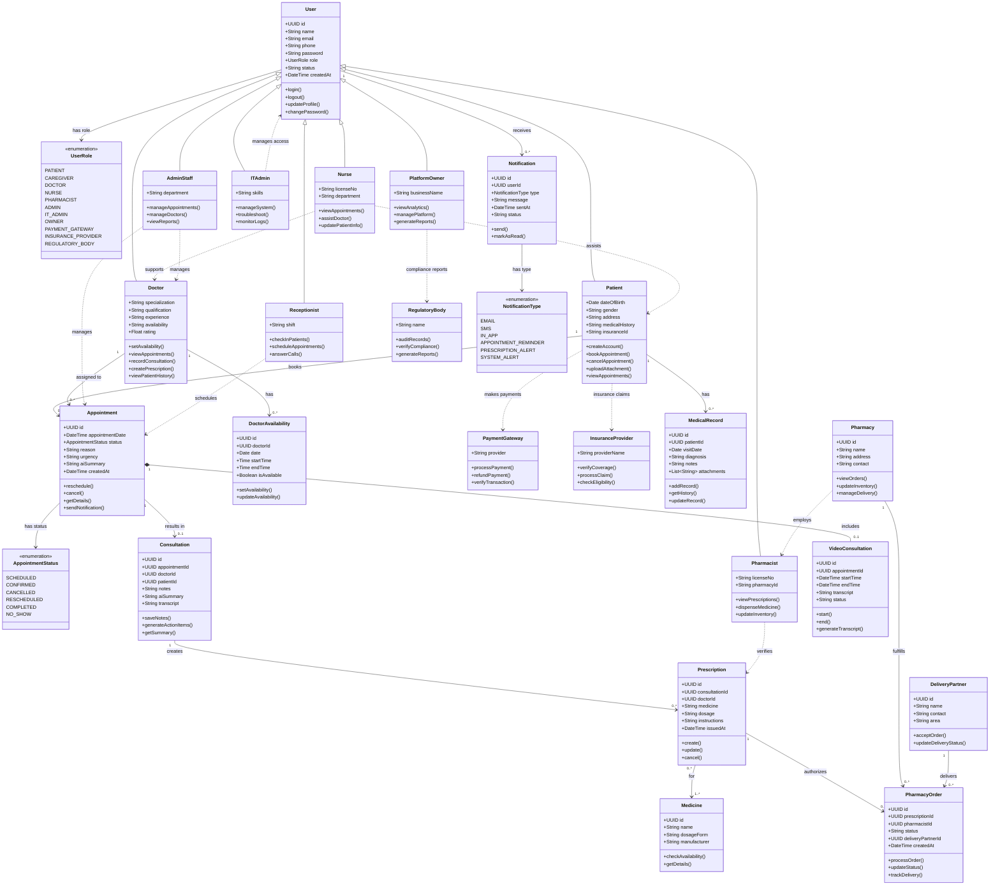

<!-- 
# Healthcare Platform — UML Class Diagram

This UML class diagram represents all 26 classes and enumerations of the Healthcare Platform, including patient management, appointments, medical records, consultations, AI assistance, pharmacy, payments, notifications, and administration. -->

## Class count

| Category | Count |
|---|---:|
| Core classes and user roles | 17 |
| Enums | 3 |
| Medical, consultation and pharmacy classes | 6 |
| **Total** | **26** |
