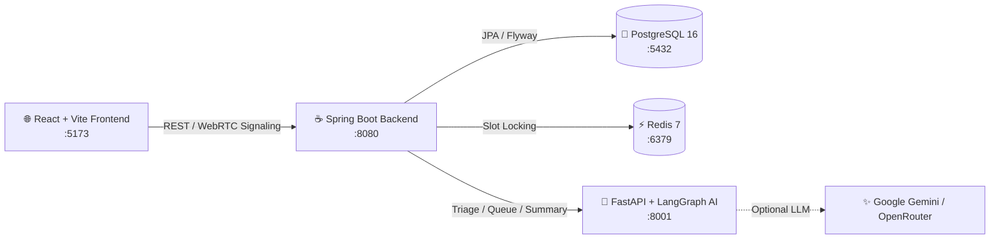

<div align="center">


# 🩺 PulseCare — Smart Healthcare Appointment, Triage & Telehealth Platform

**Group 6 · IT314 Software Engineering**

[](https://react.dev/)
[](https://www.typescriptlang.org/)
[](https://spring.io/projects/spring-boot)
[](https://openjdk.org/)
[](https://fastapi.tiangolo.com/)
[](https://www.postgresql.org/)
[](https://redis.io/)
[](https://www.docker.com/)

A full-stack digital healthcare platform where patients discover verified doctors, complete an AI-assisted symptom triage, book in-person or live WebRTC video consultations, download digitally signed PDF prescriptions, and order medicines from the integrated pharmacy.

</div>

> ⚠️ **Disclaimer:** Student / portfolio project. AI triage and consultation summaries are **advisory only**—clinicians always review and own final medical decisions. Not a certified medical service or HIPAA/DPDP compliant in its current form.

---

## 🖼️ Platform Showcase

| 🔍 Find Verified Doctors | 📹 Live Video Consultations |
| :---: | :---: |
|  |  |
| Search by specialty, hospital & live slot availability | 1-on-1 WebRTC video/audio, screen share, chat & AI summary |

| 💊 Integrated Pharmacy | 📋 Digital Health Records |
| :---: | :---: |
|  |  |
| Browse medicines, manage cart & fulfill prescriptions | Downloadable PDF prescriptions, invoices & visit summaries |

---

## ✨ Key Features

### 🔐 1. Authentication & Role-Based Portals
- **4 Dedicated Roles:** `PATIENT`, `DOCTOR` (with admin verification workflow), `PHARMACIST`, and `ADMIN`.
- **Security:** Stateless JWT access tokens + rotating refresh tokens, password reset flow, and strong password enforcement (8+ chars, uppercase, lowercase, digit, symbol) with a real-time visual strength meter.
- **Compliance:** Patient profile management, personal data export, and account deletion endpoints.

### 🩺 2. Smart Appointment Booking & Clinical Triage
- **Hospital & Doctor Discovery:** Search verified doctors by specialty, hospital, and available time slots.
- **Slot Reservation:** Redis-backed slot locking (with automatic local fallback) to prevent double-booking.
- **AI Pre-Visit Triage:** Patients submit symptoms, duration, and pain level; the AI service suggests urgency (`EMERGENCY`, `URGENT`, `ROUTINE`) and specialty, backed by deterministic red-flag safety checks.
- **Doctor Queue Advisor:** AI-assisted priority ordering and clinical alerts for a doctor's waiting queue.

### 📹 3. Live WebRTC Video Consultations
- **1-on-1 Peer-to-Peer Video & Audio:** Built with WebRTC (`RTCPeerConnection`), Google STUN servers, and an automatic animated canvas/audio fallback when no camera or microphone is present.
- **In-Call Tools:** Screen sharing, live text chat, quick clinical prompts, and real-time speech-to-text captions (via the browser's Web Speech API).
- **Post-Visit Summary:** On call end, the AI service summarizes the transcript, vitals, and doctor notes into a structured clinical summary stored in PostgreSQL.

### 💊 4. Digital Prescriptions, Pharmacy & Billing
- **E-Prescriptions:** Doctors issue signed prescriptions with itemized medications and dosage/meal timing instructions.
- **Downloadable PDFs:** Printable PDF prescriptions and appointment/pharmacy invoices generated on the backend.
- **Pharmacy Module:** Browse medicines, manage cart, place orders linked to prescriptions, and track fulfillment.
- **Payments & Receipts:** Integrated payment checkout, refunds, transactional outbox notifications, and PDF receipt generation.

---

## 🏗️ Architecture



---

## 🛠️ Tech Stack

| Layer | Technologies |
| :--- | :--- |
| **Frontend** | React 19, TypeScript, Vite, React Router, Framer Motion, GSAP, Lucide Icons |
| **Backend** | Java 21, Spring Boot 3.3.5, Spring Security 6 (JWT), Spring Data JPA, Flyway, OpenPDF |
| **AI Service** | Python 3.11, FastAPI, LangChain, LangGraph (Google Gemini or OpenRouter + deterministic fallback) |
| **Databases & Cache** | PostgreSQL 16, Redis 7 (H2 in-memory for automated tests) |
| **Infrastructure & CI** | Docker & Docker Compose, GitHub Actions (Maven + Vite + Python checks) |

---

## 📁 Repository Layout

```text
Smart_Healthcare_Appointment/
├── apps/
│   ├── backend/           # Spring Boot REST API, auth, clinic, pharmacy, payments & Flyway migrations
│   ├── frontend/          # React + Vite + TypeScript web application
│   └── ai-service/        # FastAPI + LangChain/LangGraph microservice (triage, queue advisor, summaries)
├── docker/
│   └── docker-compose.yml # PostgreSQL, Redis, Kafka/Debezium (optional), Backend, AI Service, Frontend
├── scripts/               # Helper scripts (config sync, CDC registration)
├── tests/                 # API collections and QA security/test reports
├── run-all.sh             # One-command launcher for macOS/Linux
├── stop-all.sh            # Graceful shutdown script for macOS/Linux
├── start-all.ps1          # One-command launcher for Windows PowerShell
└── stop-all.ps1           # Shutdown script for Windows PowerShell
```

---

## 📋 Prerequisites

- **Docker & Docker Compose** (for PostgreSQL and Redis)
- **JDK 21** (`java -version`)
- **Node.js 20+** and **npm** (`node -v`)
- **Python 3.11+** (`python3 --version`)

---

## ⚡ Quick Start

### Option A: One-Command Local Launch (Recommended)

**macOS / Linux:**
```bash
./run-all.sh
```
*(Run `./stop-all.sh` or press `Ctrl+C` to stop.)*

**Windows (PowerShell):**
```powershell
.\start-all.ps1
```

Once running, open:
- 🌐 **Frontend:** http://localhost:5173
- ⚙️ **Backend API & Swagger UI:** http://localhost:8080/swagger-ui.html
- 🤖 **AI Service Health & Docs:** http://localhost:8001/docs

---

### Option B: Manual Service-by-Service Setup

1. **Start PostgreSQL & Redis:**
   ```bash
   docker compose -f docker/docker-compose.yml up -d postgres redis
   ```

2. **Start the AI Service (Port `8001`):**
   ```bash
   cd apps/ai-service
   python3 -m venv venv && source venv/bin/activate
   pip install -r requirements.txt
   cp .env.example .env   # Optional: add GOOGLE_API_KEY or OPENROUTER_API_KEY
   uvicorn main:app --host 0.0.0.0 --port 8001 --reload
   ```
   > 💡 **Note:** If no LLM API key is set in `apps/ai-service/.env`, the AI service automatically runs in **deterministic fallback mode** so all workflows continue to work offline/key-free.

3. **Start the Spring Boot Backend (Port `8080`):**
   ```bash
   cd apps/backend
   ./mvnw spring-boot:run
   ```

4. **Start the React Frontend (Port `5173`):**
   ```bash
   cd apps/frontend
   npm install
   npm run dev
   ```

---

## 🔑 Seeded Demo Accounts

On startup, the backend automatically seeds sample hospitals, doctors, and staff accounts:

| Role | Email | Password |
| :--- | :--- | :--- |
| 🛡️ **Admin** | `admin@pulsecare.local` | `admin#1234` |
| 💊 **Pharmacist** | `pharmacist@pulsecare.local` | `pharma#1234` |
| 🩺 **Doctor** | Any seeded doctor email (logged at startup) | `Password123!` |
| 🧑‍⚕️ **Patient** | Self-register via `/auth` | Must satisfy strong password rules |

---

## 🧪 Running Tests & Builds

### Backend (JUnit 5 + H2 In-Memory DB)
```bash
cd apps/backend
./mvnw test
```

### Frontend (TypeScript Check + Production Build)
```bash
cd apps/frontend
npm run build
```

### AI Service (Syntax & Import Check)
```bash
cd apps/ai-service
python3 -m compileall -q .
python3 -c "import main; assert main.app is not None"
```

---

## 🤝 Development Workflow

- **Branches:** `feat/<area>-<desc>`, `fix/<area>-<desc>`
- **Commits:** Conventional Commits (e.g., `feat(auth): enforce strong password constraints`)
- **Pull Requests:** Target `main_v2`; ensure all GitHub Actions CI checks (`Backend`, `Frontend`, `AI service`) pass before merging.
