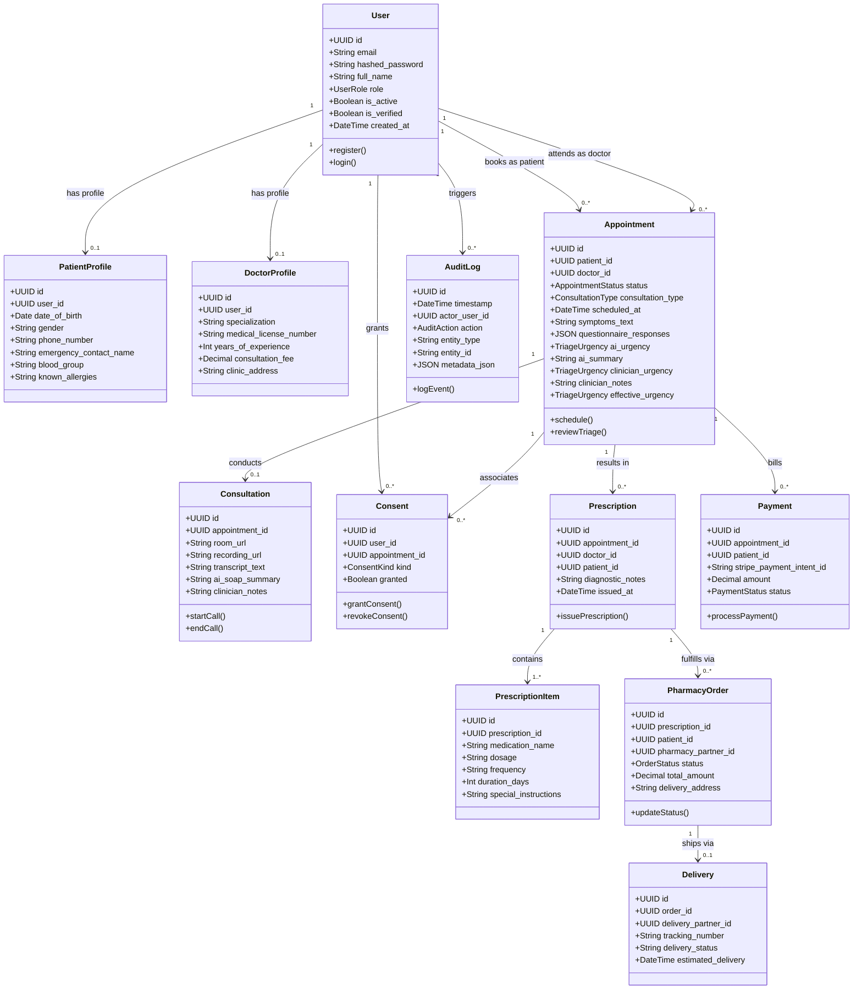

# Implements: NFR-01, NFR-02, NFR-03, FR-01, FR-03, FR-04, FR-16
# Safety:    S1, S2, S3, S4, S5, S6, S7, S8, S9, S10, DR-15
# Owner:     backend (Group 6)

# Smart Healthcare Appointment & Triage System

**Group 6 · IT314 — Software Engineering**  
**Repository:** [https://github.com/Yug-Gabani/Smart_Healthcare_Appointment](https://github.com/Yug-Gabani/Smart_Healthcare_Appointment)

A full-stack, GenAI-assisted healthcare appointment, clinical triage, and consultation platform developed for IT314 Group 6. Patients can browse verified doctors, check acute symptoms through an interactive pre-visit triage workflow without forced sign-in, and book virtual or clinic consultations. Generative AI (powered by LangGraph and Claude 3.5 Sonnet via OpenRouter) **advises** on clinical urgency and synthesizes patient history; **licensed human doctors always decide and can override**.

> [!IMPORTANT]
> **Academic Prototype Notice:** This project is a student portfolio and educational prototype. It is **not** a certified medical device and is **not** currently HIPAA/DPDP certified. AI suggestions are strictly advisory.

---

## System Class Diagram

The following UML class diagram models the core domain entities, data relationships, and operations across the clinical workflow:



> For the comprehensive physical schema, foreign key indexing, and custom PostgreSQL 16 enums, see [`docs/database_design.md`](docs/database_design.md).

---

## Team Roster (Group 6)

| Name | Role | Responsibilities |
|---|---|---|
| **Yug Gabani** | AI / GenAI Lead | LangGraph workflows, prompt engineering, emergency detection, LLM pipelines |
| **Kush Hingrajiya** | AI Engineer | Clinical summarization chains, OpenRouter integrations, prompt registry |
| **Dev Sanghani** | AI Engineer | Checkpointing, LangGraph state management, evaluation |
| **Vivek Amipara** | Backend Lead | FastAPI core architecture, SQLAlchemy async models, database migrations |
| **Parag Bera** | Backend Engineer | 3-layer RBAC, JWT authentication, appointment scheduling APIs |
| **Darsh Valand** | Backend Engineer | Append-only audit trail, PHI filtering processors, SSE doctor queues |
| **Abhibrata Sarkar**| Backend Engineer | ARQ background workers, email/SMS notifications, MinIO file presigning |
| **Hari Patel** | Frontend Lead | React 18 architecture, Practo-inspired discovery portal, guest triage modal |
| **Vikas Bhabhor** | Frontend Engineer | Clinician queue UI, doctor decision panels, TanStack Query integration |

---

## Locked Tech Stack

### Frontend (`apps/frontend`)
- **Core:** `react@18.3.1`, `vite@5.4.5`, `typescript@5.5.4`
- **Styling & UI:** `tailwindcss@3.4.11`, `shadcn/ui` (Radix primitives), `lucide-react@0.441.0`
- **Routing & State:** `react-router-dom@6.26.2`, `@tanstack/react-query@5.56.2`, `zustand@4.5.5`
- **Forms & Validation:** `react-hook-form@7.53.0`, `zod@3.23.8`
- **Telemetry & Video:** `recharts@2.12.7`, `@daily-co/daily-react@0.20.0`, `sonner@1.5.0`
- **Testing & Tooling:** `vitest@2.1.1`, `@testing-library/react@16.0.1`, `eslint@9.10.0`, `prettier@3.3.3`
- **Package Manager:** `pnpm@9` / `npm`

### Backend (`apps/backend`)
- **Runtime & Web Framework:** `python@3.11`, `fastapi@0.115.0`, `uvicorn[standard]==0.30.6`
- **Persistence & Migrations:** `sqlalchemy@2.0.35` (async), `asyncpg@0.29.0`, `alembic@1.13.3`
- **Validation & Settings:** `pydantic@2.9.2`, `pydantic-settings@2.5.2`
- **Auth & Security:** `fastapi-users@13.0.0`, `passlib[bcrypt]==1.7.4`, `python-jose[cryptography]==3.3.0`
- **Observability & Logging:** `structlog@24.4.0` (with strict PHI scrubbing processor), `sentry-sdk@2.14.0`
- **Async Queue & Clients:** `arq@0.26.1`, `sse-starlette@2.1.3`, `httpx@0.27.2`, `boto3@1.35.36`, `stripe@10.12.0`
- **Testing & Code Quality:** `pytest@8.3.3`, `pytest-asyncio@0.24.0`, `ruff@0.6.9`
- **Package Manager:** `uv` / `pip`

### AI & Clinical Advisory (`apps/backend/src/ai/`)
- **Orchestration:** `langgraph@0.2.28`, `langchain@0.3.1`, `langchain-core@0.3.1`, `langchain-openai@0.2.1`
- **State Checkpointing:** `langgraph-checkpoint-postgres@1.0.0`
- **Model:** `anthropic/claude-3.5-sonnet` (routed via OpenRouter)

### Infrastructure & External Services
- **Database:** PostgreSQL 16 Alpine (Host port: `5433`)
- **In-Memory Cache & Queue:** Redis 7 Alpine (Host port: `6380`)
- **Object Storage:** MinIO S3 (Host port: `9000`, Web Console: `9001`)
- **Third-Party APIs:** OpenRouter · Deepgram · Daily.co · Stripe · Resend · Twilio (mocked for demo)

---

## Safety Constraints (S1 – S10 & DR-15)

| Rule | Constraint | Implementation in Codebase |
|---|---|---|
| **S1** | **AI Advisory Only** | Mandatory UI banner: *"AI suggestion — for clinician review"*. AI suggestions and doctor decisions are stored in separate columns; doctors always make the final call. |
| **S2** | **Emergencies Never Queue** | LangGraph emergency branch triggers immediate `EMERGENCY_ESCALATED` status bypass before standard review queues. |
| **S3** | **Graceful AI Failure** | `manual_triage_fallback` node marks records as `AWAITING_MANUAL_TRIAGE` with `ai_error` if LLM/network fails; patient cases are never dropped. |
| **S4** | **Deterministic Keyword Pre-Check** | Questionnaire is scanned for acute indicators (`chest pain`, `unconscious`, `severe bleeding`, `cannot breathe`) *before* invoking any LLM; emergency branch fires even if offline. |
| **S5** | **Consent Before Recording** | `Consent` record with `kind=RECORDING` is mandatory before starting video/audio transcription. |
| **S6** | **Audit Every Mutation** | Every state-altering action triggers `audit(action, entity, actor)` to append immutable audit entries. |
| **S7** | **No Plaintext PHI in Logs** | `structlog` processor and `sanitize_metadata()` redact patient names, emails, phone numbers, addresses, and passwords into opaque IDs. |
| **S8** | **3-Layer RBAC** | Enforced at middleware, FastAPI endpoint dependencies (`require_role`), and scoped SQL queries (`WHERE patient_id = :id`). |
| **S9** | **Payment Never Gates Care** | Clinical triage, doctor reviews, and emergency escalations execute regardless of payment status. |
| **S10** | **Model Provenance** | Every AI output persists `ai_model`, `ai_prompt_version`, and `ai_graph_version` for auditability and model reproducibility. |
| **DR-15** | **Physical Column Separation** | `ai_*` columns (`ai_urgency`, `ai_summary`) and `clinician_*` columns (`clinician_urgency`, `clinician_notes`) exist side-by-side in PostgreSQL. Clinician reviews never overwrite raw AI outputs. |

---

## Repository Structure

```
Smart_Healthcare_Appointment/
├── apps/
│   ├── frontend/
│   │   ├── src/
│   │   │   ├── components/
│   │   │   │   └── composed/
│   │   │   │       └── AIAdvisoryBanner.tsx   # Enforces Safety S1
│   │   │   ├── routes/
│   │   │   │   ├── auth/AuthPage.tsx          # Login & registration with role selector
│   │   │   │   ├── patient/
│   │   │   │   │   ├── LandingPage.tsx        # Practo-style guest discovery & triage
│   │   │   │   │   └── PatientPortal.tsx      # Patient consultation management
│   │   │   │   └── doctor/
│   │   │   │       └── DoctorQueue.tsx        # Clinician decision panel (DR-15)
│   │   │   ├── stores/authStore.ts            # Zustand client authentication store
│   │   │   ├── lib/api.ts                     # Type-safe API client wrapper
│   │   │   ├── App.tsx                        # React Router 6 configuration
│   │   │   └── main.tsx                       # React 18 DOM mount
│   │   ├── index.html
│   │   ├── package.json                       # Pinned frontend dependencies
│   │   ├── postcss.config.js                  # Tailwind & Autoprefixer plugin setup
│   │   ├── tailwind.config.js                 # Tailwind CSS theme configuration
│   │   ├── tsconfig.json                      # Strict TypeScript compiler options
│   │   └── vite.config.ts                     # Vite build setup with '@' path alias
│   └── backend/
│       ├── src/
│       │   ├── main.py                        # FastAPI entrypoint & structlog PHI filter
│       │   ├── config.py                      # Pydantic BaseSettings configuration
│       │   ├── deps.py                        # JWT auth & 3-layer RBAC dependency factory
│       │   ├── db/
│       │   │   └── session.py                 # SQLAlchemy 2.0 async engine & sessionmaker
│       │   ├── models/
│       │   │   ├── user.py                    # User model with role enums
│       │   │   ├── appointment.py             # Appointment model with DR-15 columns
│       │   │   ├── consultation.py            # Telehealth & Consent models (S5)
│       │   │   └── audit.py                   # Append-only AuditLog model
│       │   ├── schemas/
│       │   │   └── user.py                    # Pydantic v2 schemas
│       │   ├── auth/
│       │   │   └── security.py                # Password hashing & JWT token issuance
│       │   ├── audit/
│       │   │   └── helper.py                  # Audit helper stripping PHI (S6, S7)
│       │   ├── ai/
│       │   │   ├── llm.py                     # ChatOpenAI configured for Claude 3.5
│       │   │   ├── schemas.py                 # Structured TriageOutput schema
│       │   │   ├── prompt_registry.py         # Versioned prompt management (S10)
│       │   │   ├── prompts/triage_v1.txt      # Triage prompt template
│       │   │   └── graphs/triage_graph.py     # LangGraph workflow (S1-S4)
│       │   └── api/
│       │       ├── users.py                   # Register & login endpoints
│       │       ├── appointments.py            # Pre-visit triage & review endpoints
│       │       └── audit.py                   # Admin audit trail query endpoint
│       ├── alembic/                           # Async database migrations
│       ├── Dockerfile                         # Container definition for backend
│       └── pyproject.toml                     # Pinned backend dependencies
├── docker/
│   └── docker-compose.yml                     # Postgres (5433), Redis (6380), MinIO (9000/9001)
├── pnpm-workspace.yaml                        # Monorepo configuration
├── .gitignore                                 # Ignores .venv, node_modules, .env
└── README.md
```

---

## Quickstart Guide

### 1. Start Infrastructure (Docker)
Ensure Docker Desktop is running, then execute:
```bash
docker compose -f docker/docker-compose.yml up -d
```
Verifying running containers:
- **PostgreSQL 16:** `localhost:5433` (DB: `smart_healthcare`, User: `postgres`, Password: `postgrespassword`)
- **Redis 7:** `localhost:6380`
- **MinIO S3:** `localhost:9000` (Console: `localhost:9001` · user: `minioadmin` / pass: `minioadminpassword`)

### 2. Start Backend Service (FastAPI)
```bash
cd apps/backend

# Create virtual environment and activate
python3 -m venv .venv
source .venv/bin/activate

# Install dependencies
pip install -e ".[dev]"

# Run database migrations
alembic upgrade head

# Start API server with auto-reload
uvicorn src.main:app --host 0.0.0.0 --port 8000 --reload
```
- Interactive Swagger Documentation: [http://localhost:8000/docs](http://localhost:8000/docs)
- Health Check: [http://localhost:8000/health](http://localhost:8000/health)

### 3. Start Frontend Portal (React 18 + Vite)
In a separate terminal:
```bash
cd apps/frontend

# Install dependencies
npm install    # or pnpm install

# Start Vite dev server
npm run dev    # runs on port 5173
```
- Web Application: [http://localhost:5173/](http://localhost:5173/)

---

## User Journey & Core Features

### 1. Guest Patient Discovery & Triage (Practo-Style)
- **No Forced Sign-In:** Any visitor can search doctors by specialty, filter by location (`Ahmedabad / Gandhinagar`), and review verified doctor ratings, experience, and fees.
- **Instant Pre-Visit AI Triage:** Clicking *"Check Symptoms"* or selecting any health concern (*Cold & Fever*, *Skin & Acne*, *Women's Health*, etc.) opens the triage modal immediately.
- **Real-Time Pre-Check (S4):** Red flag symptoms (e.g., chest pain, respiratory arrest) immediately trigger emergency routing with an urgent care advisory.
- **Account Transition:** Once patients view their assessment, they can optionally click *"Save Case & Sign In / Register"* to link the consultation to their medical record.

### 2. Clinical Review Queue (Doctors)
- Doctors access the clinical dashboard at `/doctor`.
- Cases display patient symptoms alongside the **S1 Advisory Banner** (*"AI suggestion — for clinician review"*).
- Under the **Clinician Decision Panel (DR-15)**, doctors confirm or override urgency classifications and enter formal clinical notes without overwriting the AI's generated reasoning.

### 3. Append-Only Audit Trail (Administrators)
- Every registration, login, pre-visit triage submission, and clinician review event is permanently recorded in PostgreSQL.
- Administrators can audit system events via `GET /api/v1/audit` to review timestamped actor IDs, actions, and entities while guaranteeing that all PHI remains stripped.

---

## Git Branching & Contribution Workflow

This project adheres to strict **Conventional Commits** and feature branch reviews:

- `main` — Production-ready baseline, protected by branch rules.
- `feat/smart-healthcare-system` — Consolidated complete project branch for pull request review.
- `feat/backend-core` — Async database foundation, domain models, RBAC, and audit trail.
- `feat/ai-triage` — LangGraph triage engine, Claude 3.5 prompts, and appointment endpoints.
- `feat/frontend-portal` — Practo-inspired patient discovery portal, guest triage, and doctor queue.

### Branch Rules Enforced on GitHub:
1. **Require Pull Request before merging:** Direct pushes to `main` are rejected.
2. **Block force pushes:** Protects commit history from destructive overwrites.
3. **Restrict deletions:** Branch cannot be accidentally removed.
4. **Require status checks to pass:** Pull requests must pass linting and typecheck suites before approval.
