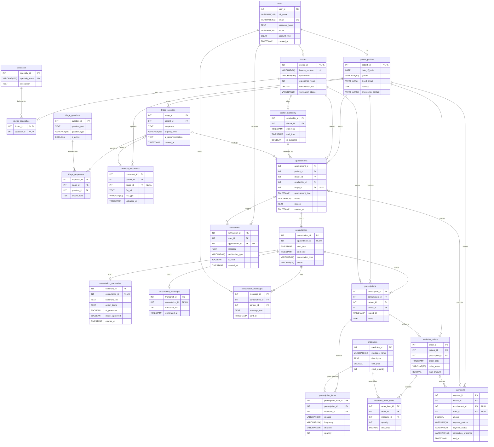

## Legend

| Symbol | Meaning |
|--------|---------|
| `PK` | Primary key |
| `FK` | Foreign key |
| `UK` | Unique key |
| `"NULL"` | Nullable column |
| `\|\|--o{` | One-to-many (1 : N / 1 : 0..N) |
| `\|\|--o\|` | One-to-zero-or-one (1 : 0..1 / 1 : 1) |
| `doctor_specialties` | Junction table for the many-to-many between doctors and specialties |