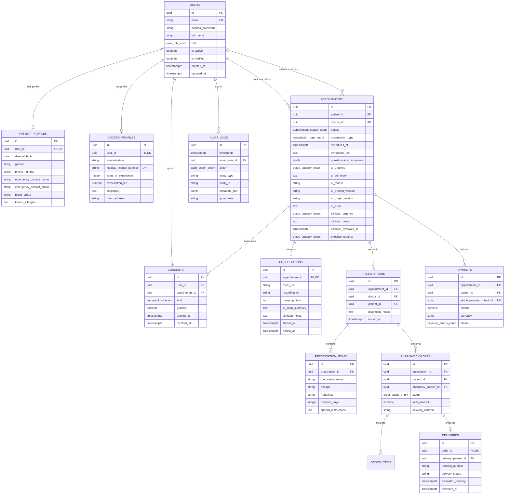

# Implements: NFR-01, NFR-02, NFR-03, NFR-04, NFR-06, FR-01, FR-02, FR-03, FR-04, FR-12, FR-16, FR-17, FR-18, FR-25, FR-26, FR-30, FR-31, FR-35, FR-42
# Safety:    S1, S2, S3, S4, S5, S6, S7, S8, S9, S10, DR-11, DR-15
# Owner:     backend (Vivek Amipara)

# Smart Healthcare System — Complete Database Design & Data Architecture

This document provides the definitive, production-grade database design for the **Smart Healthcare Appointment & Triage System** (IT314 Group 6). It details the schema, relationships, indexes, constraints, and data governance policies designed for **PostgreSQL 16**.

---

## 1. Architectural Principles & Constraints

1. **UUID Primary Keys:** All tables use UUIDv4 (`gen_random_uuid()` or Python `uuid.uuid4()`) as primary keys to prevent ID enumeration and horizontal privilege escalation (IDOR attacks).
2. **Explicit Timestamps:** Every table includes `created_at TIMESTAMP WITH TIME ZONE DEFAULT NOW()`, and mutable entities include `updated_at TIMESTAMP WITH TIME ZONE DEFAULT NOW()`.
3. **Foreign Key Integrity:** Foreign keys are explicitly defined with strict referential integrity (`ON DELETE RESTRICT` or `ON DELETE CASCADE` where domain-safe, and `ON DELETE SET NULL` for optional references).
4. **DR-15 Physical Column Separation:** AI advisory suggestions (`ai_*`) and clinician determinations (`clinician_*`) reside in physically separate columns. AI outputs are never overwritten; doctors have autonomous authority over care decisions.
5. **Effective Urgency Generated Column:** A PostgreSQL generated column computes the final operative urgency:
   ```sql
   effective_urgency triage_urgency_enum GENERATED ALWAYS AS (
       COALESCE(clinician_urgency, ai_urgency)
   ) STORED
   ```
6. **Append-Only Auditing (S6, S7):** Mutations trigger write-only insertions into `audit_logs`. Plaintext PHI is forbidden in audit metadata.
7. **Healthcare Safety Boundaries:** Patient care (triage, appointments, emergency dispatch) is decoupled from payment records (S9).

---

## 2. Entity-Relationship (ER) Diagram



---

## 3. PostgreSQL Enum Types

```sql
-- 1. System user roles (enforces 3-layer RBAC)
CREATE TYPE user_role_enum AS ENUM (
    'PATIENT',
    'CAREGIVER',
    'DOCTOR',
    'NURSE',
    'PHARMACIST',
    'PHARMACY_STAFF',
    'RECEPTION',
    'CLINIC_ADMIN',
    'SYSTEM_ADMIN'
);

-- 2. Appointment lifecycle statuses
CREATE TYPE appointment_status_enum AS ENUM (
    'PENDING_TRIAGE',
    'AWAITING_MANUAL_TRIAGE',
    'EMERGENCY_ESCALATED',
    'TRIAGED',
    'CONFIRMED',
    'IN_PROGRESS',
    'COMPLETED',
    'CANCELLED'
);

-- 3. Triage urgency classification (S1, S2, DR-15)
CREATE TYPE triage_urgency_enum AS ENUM (
    'EMERGENCY',
    'URGENT',
    'ROUTINE',
    'SELF_CARE'
);

-- 4. Consultation modality
CREATE TYPE consultation_type_enum AS ENUM (
    'VIDEO',
    'IN_PERSON'
);

-- 5. Regulatory patient consent types (S5)
CREATE TYPE consent_kind_enum AS ENUM (
    'RECORDING',
    'DATA_PROCESSING',
    'AI_ADVISORY'
);

-- 6. Pharmacy fulfillment states (FR-25, FR-30)
CREATE TYPE order_status_enum AS ENUM (
    'PENDING',
    'PROCESSING',
    'READY_FOR_PICKUP',
    'OUT_FOR_DELIVERY',
    'DELIVERED',
    'CANCELLED'
);

-- 7. Payment status (FR-31, S9)
CREATE TYPE payment_status_enum AS ENUM (
    'PENDING',
    'COMPLETED',
    'FAILED',
    'REFUNDED'
);

-- 8. Immutable audit event actions (S6)
CREATE TYPE audit_action_enum AS ENUM (
    'CREATE',
    'UPDATE',
    'DELETE',
    'LOGIN',
    'LOGOUT',
    'VIEW',
    'TRIAGE',
    'STATUS_CHANGE'
);
```

---

## 4. Complete Table Schema Specifications (DDL)

### 4.1 Users & Authentication (`users`)
Core identity table compatible with FastAPI-Users.

```sql
CREATE TABLE users (
    id UUID PRIMARY KEY DEFAULT gen_random_uuid(),
    email VARCHAR(255) NOT NULL,
    hashed_password VARCHAR(255) NOT NULL,
    full_name VARCHAR(128) NOT NULL,
    role user_role_enum NOT NULL DEFAULT 'PATIENT',
    is_active BOOLEAN NOT NULL DEFAULT TRUE,
    is_verified BOOLEAN NOT NULL DEFAULT FALSE,
    email_verified_at TIMESTAMP WITH TIME ZONE NULL,
    created_at TIMESTAMP WITH TIME ZONE NOT NULL DEFAULT NOW(),
    updated_at TIMESTAMP WITH TIME ZONE NOT NULL DEFAULT NOW()
);

CREATE UNIQUE INDEX uq_users_email ON users (LOWER(email));
CREATE INDEX ix_users_role_is_active ON users (role, is_active);
```

---

### 4.2 Patient Profile (`patient_profiles`)
Demographic and medical background isolated from authentication credentials.

```sql
CREATE TABLE patient_profiles (
    id UUID PRIMARY KEY DEFAULT gen_random_uuid(),
    user_id UUID NOT NULL REFERENCES users(id) ON DELETE CASCADE,
    date_of_birth DATE NULL,
    gender VARCHAR(32) NULL,
    phone_number VARCHAR(32) NULL,
    emergency_contact_name VARCHAR(128) NULL,
    emergency_contact_phone VARCHAR(32) NULL,
    blood_group VARCHAR(8) NULL,
    known_allergies TEXT NULL,
    medical_history_summary TEXT NULL,
    created_at TIMESTAMP WITH TIME ZONE NOT NULL DEFAULT NOW(),
    updated_at TIMESTAMP WITH TIME ZONE NOT NULL DEFAULT NOW(),
    CONSTRAINT uq_patient_profiles_user_id UNIQUE (user_id)
);

CREATE INDEX ix_patient_profiles_phone ON patient_profiles (phone_number);
```

---

### 4.3 Doctor Profile (`doctor_profiles`)
Professional credentials, clinical specialization, and consultation pricing.

```sql
CREATE TABLE doctor_profiles (
    id UUID PRIMARY KEY DEFAULT gen_random_uuid(),
    user_id UUID NOT NULL REFERENCES users(id) ON DELETE CASCADE,
    specialization VARCHAR(128) NOT NULL,
    medical_license_number VARCHAR(64) NOT NULL,
    years_of_experience INTEGER NOT NULL DEFAULT 0,
    consultation_fee NUMERIC(10, 2) NOT NULL DEFAULT 0.00,
    biography TEXT NULL,
    clinic_address VARCHAR(255) NULL,
    created_at TIMESTAMP WITH TIME ZONE NOT NULL DEFAULT NOW(),
    updated_at TIMESTAMP WITH TIME ZONE NOT NULL DEFAULT NOW(),
    CONSTRAINT uq_doctor_profiles_user_id UNIQUE (user_id),
    CONSTRAINT uq_doctor_license_number UNIQUE (medical_license_number)
);

CREATE INDEX ix_doctor_profiles_specialization ON doctor_profiles (specialization);
```

---

### 4.4 Appointments & Clinical Triage (`appointments`)
Enforces **DR-15 physical separation** and **S10 AI model provenance**.

```sql
CREATE TABLE appointments (
    id UUID PRIMARY KEY DEFAULT gen_random_uuid(),
    patient_id UUID NOT NULL REFERENCES users(id) ON DELETE CASCADE,
    doctor_id UUID NULL REFERENCES users(id) ON DELETE SET NULL,
    status appointment_status_enum NOT NULL DEFAULT 'PENDING_TRIAGE',
    consultation_type consultation_type_enum NOT NULL DEFAULT 'VIDEO',
    scheduled_at TIMESTAMP WITH TIME ZONE NULL,
    
    -- Patient pre-visit intake data
    symptoms_text TEXT NOT NULL,
    questionnaire_responses JSONB NOT NULL DEFAULT '{}'::jsonb,

    -- AI Advisory Fields (DR-15 & S1, S2, S3, S10)
    ai_urgency triage_urgency_enum NULL,
    ai_summary TEXT NULL,
    ai_model VARCHAR(64) NULL,
    ai_prompt_version VARCHAR(32) NULL,
    ai_graph_version VARCHAR(32) NULL,
    ai_error TEXT NULL,

    -- Clinician Decision Fields (DR-15 Autonomous Authority)
    clinician_urgency triage_urgency_enum NULL,
    clinician_notes TEXT NULL,
    clinician_reviewed_at TIMESTAMP WITH TIME ZONE NULL,

    -- Computed Effective Urgency
    effective_urgency triage_urgency_enum GENERATED ALWAYS AS (
        COALESCE(clinician_urgency, ai_urgency)
    ) STORED,

    created_at TIMESTAMP WITH TIME ZONE NOT NULL DEFAULT NOW(),
    updated_at TIMESTAMP WITH TIME ZONE NOT NULL DEFAULT NOW()
);

CREATE INDEX ix_appointments_patient_created ON appointments (patient_id, created_at DESC);
CREATE INDEX ix_appointments_doctor_status ON appointments (doctor_id, status);
CREATE INDEX ix_appointments_status_scheduled ON appointments (status, scheduled_at);
CREATE INDEX ix_appointments_effective_urgency ON appointments (effective_urgency);
```

---

### 4.5 Patient Consents (`consents`)
Enforces **Safety S5 (Consent before recording)** and DPDP/GDPR requirements.

```sql
CREATE TABLE consents (
    id UUID PRIMARY KEY DEFAULT gen_random_uuid(),
    user_id UUID NOT NULL REFERENCES users(id) ON DELETE CASCADE,
    appointment_id UUID NULL REFERENCES appointments(id) ON DELETE CASCADE,
    kind consent_kind_enum NOT NULL,
    granted BOOLEAN NOT NULL DEFAULT TRUE,
    granted_at TIMESTAMP WITH TIME ZONE NOT NULL DEFAULT NOW(),
    revoked_at TIMESTAMP WITH TIME ZONE NULL,
    created_at TIMESTAMP WITH TIME ZONE NOT NULL DEFAULT NOW()
);

CREATE INDEX ix_consents_user_kind_granted ON consents (user_id, kind, granted);
CREATE INDEX ix_consents_appointment_kind ON consents (appointment_id, kind);
```

---

### 4.6 Telehealth Consultations (`consultations`)
Stores WebRTC room metadata, recording references, transcripts, and SOAP notes.

```sql
CREATE TABLE consultations (
    id UUID PRIMARY KEY DEFAULT gen_random_uuid(),
    appointment_id UUID NOT NULL REFERENCES appointments(id) ON DELETE CASCADE,
    room_url VARCHAR(512) NULL,
    recording_url VARCHAR(512) NULL,
    transcript_text TEXT NULL,
    
    -- DR-15 Separation on Clinical Notes
    ai_soap_summary TEXT NULL,
    clinician_notes TEXT NULL,

    started_at TIMESTAMP WITH TIME ZONE NULL,
    ended_at TIMESTAMP WITH TIME ZONE NULL,
    created_at TIMESTAMP WITH TIME ZONE NOT NULL DEFAULT NOW(),
    updated_at TIMESTAMP WITH TIME ZONE NOT NULL DEFAULT NOW(),
    CONSTRAINT uq_consultations_appointment_id UNIQUE (appointment_id)
);
```

---

### 4.7 E-Prescriptions & Items (`prescriptions`, `prescription_items`)
Formal doctor-authorized medical orders (FR-25).

```sql
CREATE TABLE prescriptions (
    id UUID PRIMARY KEY DEFAULT gen_random_uuid(),
    appointment_id UUID NOT NULL REFERENCES appointments(id) ON DELETE CASCADE,
    doctor_id UUID NOT NULL REFERENCES users(id) ON DELETE RESTRICT,
    patient_id UUID NOT NULL REFERENCES users(id) ON DELETE CASCADE,
    diagnostic_notes TEXT NULL,
    issued_at TIMESTAMP WITH TIME ZONE NOT NULL DEFAULT NOW(),
    created_at TIMESTAMP WITH TIME ZONE NOT NULL DEFAULT NOW(),
    updated_at TIMESTAMP WITH TIME ZONE NOT NULL DEFAULT NOW()
);

CREATE INDEX ix_prescriptions_patient ON prescriptions (patient_id, issued_at DESC);
CREATE INDEX ix_prescriptions_doctor ON prescriptions (doctor_id, issued_at DESC);

CREATE TABLE prescription_items (
    id UUID PRIMARY KEY DEFAULT gen_random_uuid(),
    prescription_id UUID NOT NULL REFERENCES prescriptions(id) ON DELETE CASCADE,
    medication_name VARCHAR(255) NOT NULL,
    dosage VARCHAR(64) NOT NULL,
    frequency VARCHAR(64) NOT NULL,
    duration_days INTEGER NOT NULL,
    special_instructions TEXT NULL,
    created_at TIMESTAMP WITH TIME ZONE NOT NULL DEFAULT NOW()
);

CREATE INDEX ix_prescription_items_prescription ON prescription_items (prescription_id);
```

---

### 4.8 Pharmacy Orders & Tracking (`pharmacy_orders`, `order_items`, `deliveries`)
Manages partner fulfillment and delivery updates (FR-25, FR-26, FR-30).

```sql
CREATE TABLE pharmacy_orders (
    id UUID PRIMARY KEY DEFAULT gen_random_uuid(),
    prescription_id UUID NOT NULL REFERENCES prescriptions(id) ON DELETE RESTRICT,
    patient_id UUID NOT NULL REFERENCES users(id) ON DELETE CASCADE,
    pharmacy_partner_id UUID NULL REFERENCES users(id) ON DELETE SET NULL,
    status order_status_enum NOT NULL DEFAULT 'PENDING',
    total_amount NUMERIC(10, 2) NOT NULL DEFAULT 0.00,
    delivery_address TEXT NOT NULL,
    created_at TIMESTAMP WITH TIME ZONE NOT NULL DEFAULT NOW(),
    updated_at TIMESTAMP WITH TIME ZONE NOT NULL DEFAULT NOW()
);

CREATE INDEX ix_pharmacy_orders_patient_status ON pharmacy_orders (patient_id, status);
CREATE INDEX ix_pharmacy_orders_partner ON pharmacy_orders (pharmacy_partner_id, status);

CREATE TABLE order_items (
    id UUID PRIMARY KEY DEFAULT gen_random_uuid(),
    order_id UUID NOT NULL REFERENCES pharmacy_orders(id) ON DELETE CASCADE,
    medication_name VARCHAR(255) NOT NULL,
    quantity INTEGER NOT NULL DEFAULT 1,
    unit_price NUMERIC(10, 2) NOT NULL DEFAULT 0.00
);

CREATE TABLE deliveries (
    id UUID PRIMARY KEY DEFAULT gen_random_uuid(),
    order_id UUID NOT NULL REFERENCES pharmacy_orders(id) ON DELETE CASCADE,
    delivery_partner_id UUID NULL REFERENCES users(id) ON DELETE SET NULL,
    tracking_number VARCHAR(64) NOT NULL,
    delivery_status VARCHAR(64) NOT NULL DEFAULT 'MANIFEST_CREATED',
    estimated_delivery TIMESTAMP WITH TIME ZONE NULL,
    delivered_at TIMESTAMP WITH TIME ZONE NULL,
    created_at TIMESTAMP WITH TIME ZONE NOT NULL DEFAULT NOW(),
    updated_at TIMESTAMP WITH TIME ZONE NOT NULL DEFAULT NOW(),
    CONSTRAINT uq_deliveries_order_id UNIQUE (order_id),
    CONSTRAINT uq_deliveries_tracking_number UNIQUE (tracking_number)
);
```

---

### 4.9 Payments & Billing (`payments`)
Tracks Stripe payment state (FR-31). Follows **Safety S9 (Payment does not gate care)**.

```sql
CREATE TABLE payments (
    id UUID PRIMARY KEY DEFAULT gen_random_uuid(),
    appointment_id UUID NULL REFERENCES appointments(id) ON DELETE SET NULL,
    patient_id UUID NOT NULL REFERENCES users(id) ON DELETE CASCADE,
    stripe_payment_intent_id VARCHAR(255) NOT NULL,
    amount NUMERIC(10, 2) NOT NULL,
    currency VARCHAR(3) NOT NULL DEFAULT 'INR',
    status payment_status_enum NOT NULL DEFAULT 'PENDING',
    created_at TIMESTAMP WITH TIME ZONE NOT NULL DEFAULT NOW(),
    updated_at TIMESTAMP WITH TIME ZONE NOT NULL DEFAULT NOW(),
    CONSTRAINT uq_payments_stripe_pi UNIQUE (stripe_payment_intent_id)
);

CREATE INDEX ix_payments_patient ON payments (patient_id, created_at DESC);
CREATE INDEX ix_payments_status ON payments (status);
```

---

### 4.10 Append-Only Audit Trail (`audit_logs`)
Enforces **S6 (Audit every mutation)** and **S7 (No plaintext PHI in logs)**.

```sql
CREATE TABLE audit_logs (
    id UUID PRIMARY KEY DEFAULT gen_random_uuid(),
    timestamp TIMESTAMP WITH TIME ZONE NOT NULL DEFAULT NOW(),
    actor_user_id UUID NULL REFERENCES users(id) ON DELETE SET NULL,
    action audit_action_enum NOT NULL,
    entity_type VARCHAR(64) NOT NULL,
    entity_id VARCHAR(64) NULL,
    metadata_json JSONB NOT NULL DEFAULT '{}'::jsonb,
    ip_address VARCHAR(45) NULL,
    user_agent VARCHAR(255) NULL
);

-- Compound indexes optimized for compliance queries
CREATE INDEX ix_audit_logs_timestamp_desc ON audit_logs (timestamp DESC);
CREATE INDEX ix_audit_logs_entity ON audit_logs (entity_type, entity_id, timestamp DESC);
CREATE INDEX ix_audit_logs_actor ON audit_logs (actor_user_id, timestamp DESC);
```

---

## 5. Indexing & Optimization Strategy

| Index Name | Table | Columns | Purpose |
|---|---|---|---|
| `uq_users_email` | `users` | `LOWER(email)` (Unique) | Case-insensitive fast login lookup. |
| `ix_appointments_status_scheduled` | `appointments` | `(status, scheduled_at)` | Doctor queue filtering and upcoming appointment dispatching. |
| `ix_appointments_effective_urgency`| `appointments` | `(effective_urgency)` | Immediate filtering of emergency cases (`EMERGENCY_ESCALATED`). |
| `ix_consents_user_kind_granted` | `consents` | `(user_id, kind, granted)` | Millisecond check before allowing audio recording/transcription (S5). |
| `ix_audit_logs_entity` | `audit_logs` | `(entity_type, entity_id, timestamp DESC)` | Fast chronological audit trail queries by resource. |

---

## 6. Alembic Migration Implementation Plan

Migrations are structured into incremental steps:

1. **`0001_initial_users.py`:** Create `user_role_enum`, `users`, `patient_profiles`, and `doctor_profiles`.
2. **`0002_audit_log.py`:** Create `audit_action_enum` and `audit_logs` table with compound indexes.
3. **`0003_appointments_and_triage.py`:** Create `appointment_status_enum`, `triage_urgency_enum`, `consultation_type_enum`, and `appointments` table (with DR-15 columns and generated column).
4. **`0004_consultations_and_consents.py`:** Create `consent_kind_enum`, `consents`, and `consultations`.
5. **`0005_prescriptions_and_pharmacy.py`:** Create `order_status_enum`, `prescriptions`, `prescription_items`, `pharmacy_orders`, `order_items`, and `deliveries`.
6. **`0006_payments_and_billing.py`:** Create `payment_status_enum` and `payments`.
